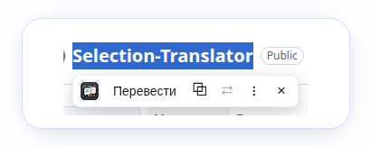

# Selection Translator

Selection Translator — компактное расширение для Chromium-браузеров, которое переводит выделенный текст прямо на странице. Выделите фрагмент, нажмите `Перевести` или `Скопировать` — результат появится в аккуратной плавающей панели без перехода на отдельный сайт.

<p align="center">
  
</p>

Проект сделан как Manifest V3-расширение и подходит для Chrome, Yandex Browser и других Chromium-браузеров, которые поддерживают нужные API расширений.

## Возможности

- Плавающая панель действий рядом с выделенным текстом.
- Перевод в небольшом окне со скроллом для длинных фрагментов.
- Копирование исходного текста и готового перевода, в том числе перевод с копированием одной кнопкой `⇄`. Она копирует только перевод, пришедший для текущего выделения. Если окно перевода закрыли раньше, чем пришёл ответ, буфер обмена не меняется. Если вкладка за это время потеряла фокус, перевод тоже не копируется, а окно подскажет нажать `⧉`.
- Нативное контекстное меню браузера для выделенного текста.
- Настройки провайдера, языка перевода, лимита символов и поведения панели.
- Поддержка Google web, Yandex Cloud Translate и эндпоинта, совместимого с LibreTranslate.
- Устойчивость к ограничению доступа со стороны Google: цепочка адресов, кэш, паузы и переход на второго провайдера.
- Настраиваемая прозрачность панели с размытием фона.

## Как выглядит рабочий сценарий

1. Выделите текст на любой обычной веб-странице.
2. Нажмите `Перевести` в плавающей панели.
3. Проверьте перевод в небольшом окне рядом с выделением.
4. Скопируйте исходный текст или перевод одной кнопкой.
5. При необходимости поменяйте провайдера и язык в настройках расширения.

## Установка для разработки

1. Склонируйте репозиторий.
2. Установите зависимости: `npm ci`.
3. Соберите расширение: `npm run build`.
4. Откройте в браузере страницу `chrome://extensions`.
5. Включите режим разработчика.
6. Нажмите `Загрузить распакованное расширение`.
7. Выберите папку `dist/`.

После изменений в TypeScript-коде или `manifest.json` запустите `npm run build` и перезагрузите расширение на странице расширений.

## Команды

| Команда | Что делает |
| --- | --- |
| `npm run lint` | Проверяет код через Biome: линтер, форматирование и порядок импортов |
| `npm run lint:fix` | Форматирует код и применяет безопасные исправления Biome |
| `npm run typecheck` | Проверяет TypeScript в строгом режиме без записи файлов |
| `npm test` | Запускает тесты через встроенный Node.js test runner и `tsx` |
| `npm run build` | Собирает рабочее Manifest V3-расширение в `dist/` |
| `npm run verify` | Запускает lint, typecheck, тесты и сборку |
| `npm run release-notes -- 1.4.0` | Печатает раздел версии из `CHANGELOG.md`: так CD получает текст GitHub Release |
| `npm run pack` | Собирает расширение и упаковывает `dist/` в zip-архив в `outputs/` |
| `npm run zip` | Упаковывает уже собранный `dist/` без пересборки, так делает CI |

Готовый архив появляется здесь:

```text
outputs/selection-translator-extension.zip
```

Папки `dist/` и `outputs/` не версионируются.

## CI/CD

Проверки и релиз описаны одним сценарием GitHub Actions: `.github/workflows/ci.yml`. Версия Node.js берётся из `.nvmrc`, сейчас это 24 LTS. Расширение собирается один раз, дальше по сценарию передаётся готовый архив.

### CI

CI запускается на pull request, push в `main`, push тега версии и вручную. Задача `Verify extension`:

- ставит зависимости через `npm ci`, npm-кэш переиспользуется между запусками, пока не изменится `package-lock.json`;
- отдельными шагами запускает lint, typecheck, тесты и сборку, поэтому в логе сразу видно, какая проверка упала;
- упаковывает собранный `dist/` в zip без повторной сборки;
- сохраняет архив как артефакт запуска на 14 дней: его можно скачать и установить, не собирая расширение локально.

### CD

CD запускается только при отправке git-тега версии, например `v1.0.0` или `v1.0`.

На теге задача `Verify extension` дополнительно:

- приводит короткий тег вида `v1.0` к версии `1.0.0`;
- сверяет версию тега с `version` в `package.json` и `manifest.json`, причём ещё до установки зависимостей;
- берёт текст релиза из раздела этой версии в `CHANGELOG.md`.

Затем задача `Publish release` скачивает артефакт и публикует GitHub Release. Она ничего не собирает заново, поэтому в релиз попадает ровно тот архив, который прошёл проверки. Права на запись в репозиторий есть только у этой задачи.

Перед релизом добавьте в `CHANGELOG.md` раздел `## X.Y.Z - ГГГГ-ММ-ДД` для новой версии: его текст станет описанием GitHub Release. Тесты проверяют, что такой раздел есть для версии из `package.json`, а версии в `package.json`, `package-lock.json` и `manifest.json` совпадают.

Пример релиза:

```bash
git tag v1.0.0
git push origin v1.0.0
```

Если номер тега не совпадает с версиями в `package.json` и `manifest.json`, а также если в `CHANGELOG.md` нет раздела этой версии или он пустой, релиз остановится.

## Структура проекта

| Путь | Назначение |
| --- | --- |
| `CHANGELOG.md` | Журнал изменений по версиям, источник текста GitHub Release |
| `manifest.json` | Конфигурация Manifest V3 расширения, указывает на JS-файлы в собранном `dist/` |
| `src/` | TypeScript-код content script, background service worker, настроек и переводчиков |
| `popup/` | Popup расширения: HTML/CSS и TypeScript entrypoint |
| `options/` | Страница настроек: HTML/CSS и TypeScript entrypoint |
| `assets/` | Иконки расширения: SVG-исходники и отрисованные из них PNG. В сборку попадают только файлы, которые расширение загружает |
| `scripts/` | Сборка TypeScript-исходников в рабочий `dist/`, список ассетов, которые в неё входят, и выборка текста релиза из `CHANGELOG.md` |
| `tests/` | Тесты manifest, состава сборки, UI-скриптов, настроек и переводчиков |
| `docs/` | Скриншоты для README и проектные спецификации |
| `.github/workflows/` | Сценарий GitHub Actions: проверки, сборка и публикация релиза |
| `.nvmrc` | Версия Node.js для разработки и CI |

## Провайдеры перевода

Расширение умеет работать с несколькими провайдерами:

- Google web;
- Yandex Cloud Translate;
- эндпоинт, совместимый с LibreTranslate.

Для провайдеров, которым нужны ключи или собственный эндпоинт, значения задаются в настройках расширения и не хранятся в репозитории.

## Устойчивость Google-провайдера

Google web работает без ключа, поэтому доступ ограничивается по IP-адресу и отвечает 429 со страницей «Sorry... automated queries». Чтобы перевод не падал, расширение делает так:

- запрос идет по цепочке из трех адресов Google, начиная с `clients5.google.com` с клиентом `dict-chrome-ex`, который отвечает даже там, где `translate.googleapis.com` уже отдает 429;
- текст уходит в теле POST-запроса, а не в URL: длинный GET-адрес Google отклоняет с ошибкой 400 примерно от 2500 знаков кириллицы;
- запросы разнесены по времени с джиттером, а после 429 включается пауза, вместо повторного долбления адреса;
- переводы кэшируются на 30 минут, одинаковые параллельные запросы склеиваются в один;
- если Google ограничил доступ, а в настройках есть ключ Yandex Cloud или собственный эндпоинт, перевод автоматически уходит туда. Отключается галочкой «Если Google ограничил доступ, переводить через Yandex или свой endpoint».

Заголовки `User-Agent` и `Referer` расширение не подменяет: `fetch` их запрещает, а `declarativeNetRequest` потребовал бы лишних разрешений.

## Внешний вид

Панель перевода и страница настроек переработаны под задачу: сначала читается перевод, остальное не мешает.

- текст перевода идет 15 пикселями с межстрочным 1.55, а выделение со страницы чистится от табличных палок, маркеров списка, мягких переносов и разрывов строк;
- пока идет запрос, в панели видно скелет из трех строк вместо одинокой надписи, и он же не дает панели дергаться при появлении ответа;
- у кнопок появились состояния нажатия и фокуса с клавиатуры, а панель открывается коротким появлением на 170 мс, которое отключается при `prefers-reduced-motion`;
- прозрачность панели настраивается от 25 до 100 процентов, по умолчанию 75. Просвечивает только фон: текст, рамки и тени остаются плотными, а страница под панелью размывается, поэтому перевод читается и на пестром сайте. При 100 процентах размытие выключается полностью — это вариант для компьютеров без аппаратного ускорения графики. Замер нагрузки и источники, на которые опирается решение, описаны в [спецификации](docs/specs/2026-10-19-panel-translucency-design.md).

Страница настроек разбита на четыре раздела с описаниями, поля провайдера показываются только для выбранного сервиса, исходный язык появляется при выключенном автоопределении. Кнопка «Сохранить» активна только когда есть несохраненные изменения, а панель действий закреплена внизу окна. Ползунок прозрачности сопровождается живым превью панели поверх макета страницы.

## Обновление до 1.4.0

Версия 1.4.0 меняет кнопку `⇄` в панели действий: теперь она переводит выделенный текст и сразу копирует перевод одним нажатием. Перевод копируется, только если окно ещё открыто и вкладка в фокусе, иначе окно подскажет нажать `⧉`.

Прозрачность панели по умолчанию стала 75 %, а ползунок в настройках идёт от 25 до 100 %. Если вы раньше сохраняли настройки или меняли язык в окне перевода, останется прежнее значение: в 1.3.0 это 100 %, то есть без размытия. Если панель осталась непрозрачной, переместите ползунок прозрачности на странице настроек; 100 % выключает размытие фона. Также обновлены значки расширения. Полный список изменений смотрите в [CHANGELOG.md](CHANGELOG.md).

## Обновление до 1.3.0

Версия 1.3.0 добавляет настройку прозрачности панели, переработанные панель перевода и страницу настроек, а также чистку выделенного текста перед переводом.

## Обновление до 1.2.0

Версия 1.2.0 переводит Google-провайдера на цепочку адресов и POST-запросы, добавляет кэш, паузы после 429 и автоматический переход на второго провайдера. В `host_permissions` добавлен `https://clients5.google.com/*`, поэтому Chrome попросит подтвердить обновленные разрешения.

## Обновление до 1.1.1

Версия 1.1.1 убирает экспериментальный провайдер Yandex web, потому что он требовал подмены сетевых заголовков. Yandex Cloud Translate остаётся доступен как основной Yandex-провайдер.

Если раньше был сохранён общий API-ключ, расширение перенесёт его в ключ активного провайдера: Yandex Cloud или LibreTranslate. После сохранения настроек старое общее поле ключа удаляется из хранилища.

Названия сторонних сервисов используются только для выбора провайдера перевода. Иконки и оформление расширения остаются собственными ассетами проекта.

## Лицензия

Apache-2.0. Подробности см. в [LICENSE](LICENSE).
